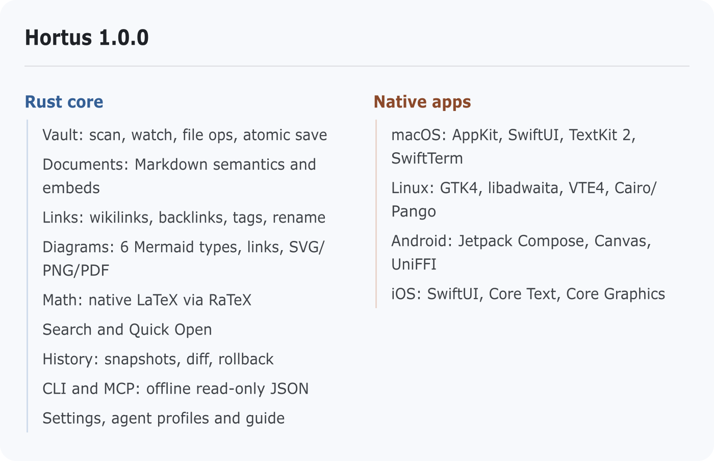
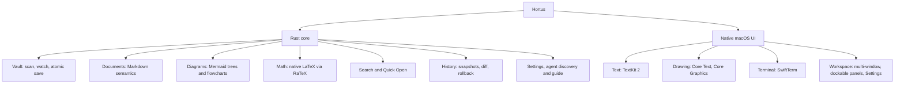

<h1>Hortus</h1>
<p><strong><a href="README.zh-CN.md">简体中文</a></strong></p>

Hortus is a native macOS Markdown knowledge viewer built for reading alongside AI agents. Open your notes directly, run command-line agents in a built-in terminal after an automatic full-vault snapshot, review and roll back changes in place, and read large Mermaid diagrams and LaTeX math without leaving the page.


[](https://github.com/groundgrounder/Hortus/releases)

## Why Hortus

Most note apps are built around typing. As agents draft, organize, and update more of your notes, you spend more time reading, verifying diffs, and keeping large diagrams legible. Hortus puts reading first, snapshots your vault before an agent runs, and keeps editing one keystroke away.

| | Typical write-first note app | Hortus |
|---|---|---|
| Opening a note | Opens in an editor | Opens in a reading view; `⌘E` switches to editing |
| Working with an agent | A plugin, or a terminal in another window | Built-in shell and agent tabs at the vault root (`⌃\``); changes refresh in place |
| Safety net for agent edits | Manual Git commits or separate backups | Automatic full-vault snapshot before launch; review diffs and roll back a hunk, file, or session |
| Large Mermaid diagrams | Scaled down to fit, or scrolled sideways | Balanced columns for trees, native flowcharts, sequence and state diagrams, plus Focus Mode (`⇧⌘D`) |
| Runtime and footprint | Often a web app with a bundled browser engine | Native Swift (AppKit and SwiftUI) on a Rust core; 18.0 MiB installed, 1 process |
| Your notes folder | Often stores app state and settings too | Holds only your files; settings live in `~/.config/hortus` and snapshots in Application Support |

## Features

### Reading and native LaTeX math

<picture>
  <source media="(prefers-color-scheme: dark)" srcset="docs/images/workspace-reading-dark.png">
  
</picture>

- Headings, lists, tasks, quotes, callouts, footnotes, code blocks, tables, and local images render natively with Markdown markers and comments (`<!-- … -->` and `%% … %%`) hidden. YAML frontmatter displays as compact properties.
- Inline (`$…$`) and display (`$$…$$`) LaTeX formulas typeset natively via RaTeX and Core Text, including inside lists, quotes, callouts, and tables, following light and dark appearance. Selecting and copying text preserves the original `$` or `$$` LaTeX source, VoiceOver reads formulas in reading order, and malformed formulas show their source and reason in place without breaking the rest of the note.
- Tables fit the note width while keeping column alignment, and wide tables scroll sideways inside the table. Images preserve aspect ratio and open in Quick Look on click.
- Tick a task checkbox in the reading view to write the change back to the file. Click `[[wikilinks]]` (including heading targets) and `#tags` directly in reading view, right-click to copy a block's Markdown source, or jump to headings from the Outline sidebar.

### Working safely with an agent

<picture>
  <source media="(prefers-color-scheme: dark)" srcset="docs/images/changes-review-dark.png">
  
</picture>

- Press `⌃\`` to toggle the built-in terminal at the vault root (`HORTUS_VAULT` set to the vault path), press `⌘T` for another shell, or start a configured agent in its own tab. The terminal supports Nerd Font icon fallback and custom monospace fonts.
- Before launching an agent, Hortus captures a full-vault snapshot (using APFS copy-on-write clones where supported), preserving attachments, permissions, and hidden user files while skipping `.git` and never following symlinks. If the snapshot cannot complete cleanly, the agent does not start.
- Open **Settings (`⌘,`) → Agent** to scan your login shell `PATH` and common macOS directories for installed CLIs (`omp`, `codex`, `claude`, `gemini`, `opencode`, `aider`, `goose`) without executing any binary, fill the command and argument template with one click, and customize the built-in `{guide}` (also available via `hortus guide`). Launch environments forward your enriched `PATH` even when Hortus starts from Finder or Dock.
- Agents and scripts can query any vault offline in structured JSON via the `hortus` CLI: `search`, `backlinks`, `links`, `tags`, `outline`, `orphans`, `broken-links`, and `mermaid check` / `render`.
- External edits refresh open notes in place while keeping your reading position. Inspect additions, modifications, deletions, renames, binary metadata, and line-level hunks in the **Changes** panel, roll back a single hunk, a whole file, or an entire session (with file-digest checks before writing), and remove finished snapshots from History.

### Mermaid diagrams

<picture>
  <source media="(prefers-color-scheme: dark)" srcset="docs/images/flowchart-dark.png">
  
</picture>

- Hortus parses and lays out Mermaid diagrams in Rust and draws them natively with Core Text and Core Graphics, keeping vector rendering crisp at every window size.
- When a mindmap or tree-shaped flowchart grows wider than the note, the root becomes a title and top-level branches flow into balanced columns at body text size. Resize the window to reflow columns; click any branch to fold or unfold it, and Hortus remembers folded state per diagram.
- General flowcharts render branches, merges, loops, long chains, multiple roots, common node shapes, edge labels, class styles, top-level subgraphs, and `~~~` invisible ordering links with orthogonal routing.
- Native **sequence diagrams** (`sequenceDiagram`) and **state diagrams** (`stateDiagram-v2` / `stateDiagram`) render participants, blocks, notes, activations, composite states, concurrent regions, fork/join, choice, and bidirectional or self-loop transitions using the same vector pipeline.
- **Bidirectional source linking & Focus Mode (`⇧⌘D`)**: moving the cursor in Mermaid source highlights the matching diagram element, and `⌘-click` (or the context menu) jumps back to source without relayout. Open any diagram in Focus Mode for 25%–400% vector zoom, pan, a minimap, `⌘F` node search, and per-diagram cached viewports.
- Unsupported diagram types stay visible as Mermaid source. You can validate Mermaid blocks with `hortus mermaid check` or export SVG, layout metrics, and semantic scenes offline with `hortus mermaid render`.

### Editing, file management, and safe saving

- Press `⌘E` to switch to styled Markdown source on TextKit 2: markers stay visible in a muted color while headings, emphasis, links, and callouts keep their formatting. Type `[[` for native wikilink completion, `⌘-click` links to navigate, and press `⌘E` again to return to reading at the same position.
- Create notes and folders, rename files with an automatic link-update preview across the vault, and move items to Trash from the Files sidebar or menu while keeping open tabs, undo history, and unsaved drafts safe across windows.
- Native macOS typing, input-method composition, undo/redo, and find and replace (`⌘F`, `⌥⌘F`) work across notes. Press `⌥⌘T` to align Markdown table columns in source.
- Changes auto-save one second after typing stops, and save immediately on `⌘S`, tab switch, or focus loss. Atomic content replacement keeps creation dates, Finder tags, extended attributes, file permissions, line endings, and BOM intact.
- If a note changes on disk while you have unsaved edits, Hortus lets you keep the disk copy, keep yours, or save yours as a conflict copy; failed saves retain a recovery draft.

### Knowledge panels, multi-window workspace, and search

- Open multiple vaults in separate windows (reopening an open vault brings its window forward), or drag a note tab out into its own window on the same vault with unsaved edits, selection, and undo history preserved. Open windows, tabs, view modes, and panel layouts restore on relaunch.
- Files, Search, Outline, Backlinks, Tags, Changes, Shell, and Agent share a single level of dockable tool tabs across the left sidebar (`⌃⌘S`), right sidebar (`⌥⌘I`), and bottom panel (`⌘J`), each with a `+` menu.
- **Backlinks** shows every note referencing the current note (including links inside Mermaid diagrams and embeds); **Tags** groups hierarchical `#tags` with counts and instant filtering.
- Quick Open (`⌘P`) matches note titles and paths as you type; live full-text Search (`⇧⌘F`) highlights matches across the vault and updates as files change.

### Your files and settings

- Open any ordinary Markdown folder, including an existing Obsidian vault (`.obsidian` is ignored), alongside Git, scripts, or other editors.
- **Settings (`⌘,`)** syncs two-way with `~/.config/hortus/config.toml` while preserving comments, manual entries, and unknown keys, and warns before overwriting external edits. Caches stay in `~/Library/Caches/Hortus`, and agent session snapshots live in `~/Library/Application Support/Hortus/agent-sessions/`.
- Hortus works completely offline with zero runtime networking or telemetry, and follows your system language (English and Simplified Chinese) and light or dark appearance.

## Performance

Measured on an Apple M3 MacBook Air (macOS 27.2.1) using the original [CC0 demo vault](fixtures/demo-vault/README.md); each figure is the median of five runs. See `tools/compare-obsidian.py` for the measurement setup.

| Metric | Hortus 0.4.0 |
|---|---|
| Installed size (`du`) | 18.0 MiB |
| Warm launch to note title | ~0.8 s |
| Memory with 81-node demo diagram open | ~150 MiB |
| Processes | 1 native process |

## Install

Requires **macOS 27 or later and an Apple Silicon Mac**. Version 0.4.0 uses ad-hoc signing and is not notarized.

1. Download `Hortus-0.4.0-arm64.dmg` from [Releases](https://github.com/groundgrounder/Hortus/releases), open it, and drag Hortus into Applications.
2. Open Hortus. macOS may block the first launch because it cannot verify the developer. Choose either method below to allow this copy:

**System Settings:** After the blocked attempt, click **Done**, open **System Settings → Privacy & Security**, find the message about Hortus, and click **Open Anyway**. Follow the confirmation and authentication prompts, then launch Hortus again if needed.

**Terminal:** After copying the app into Applications, run:

```sh
xattr -dr com.apple.quarantine /Applications/Hortus.app
open /Applications/Hortus.app
```

Both methods were tested on macOS 27.2. Prompt wording may vary on other macOS versions.

## Architecture

A Rust workspace (`crates/`) handles vault watching, file operations, atomic saving, Markdown semantics, link/tag graph indexing, Mermaid layout, RaTeX math, full-text search, session snapshots/diff/rollback, configuration, and read-only CLI queries. The macOS app (`apps/macos/`) is built in Swift with AppKit and SwiftUI and calls the Rust core through UniFFI. The diagram below was laid out and rendered by Hortus itself with `hortus mermaid render`.

<picture>
  <source media="(prefers-color-scheme: dark)" srcset="docs/images/architecture-dark.png">
  
</picture>

<details>
<summary>Mermaid source</summary>



</details>

## Known issues

- Version 0.4.0 is ad-hoc signed. Updating or re-downloading the app may require first-launch approval again.
- When a terminal session accesses protected folders such as Documents, macOS requests permission on behalf of Hortus. App updates may require re-granting access in **Privacy & Security → Files & Folders**.
- Mermaid support covers mindmaps, flowcharts (with branches, merges, loops, and top-level subgraphs), sequence diagrams, and state diagrams (`stateDiagram-v2` / `stateDiagram`). Unsupported diagram types stay visible as source.
- Embedded images display in full; embedded notes and other files currently show their name in place.

## Roadmap

- Full embedded notes and additional Mermaid diagram types.
- Linux desktop app sharing the same Rust core.

<details>
<summary>Continuous integration</summary>

CI runs on pull requests, pushes to `main`, and manual dispatches. Ubuntu 24.04 checks Rust formatting, Clippy, workspace tests, and math-check tests. GitHub's public-preview `xcode-27` image builds the macOS app with warnings treated as errors, runs the Swift tests, and checks the public tree and app bundle. Its documented image has macOS 27.0.1, Xcode 27.1, and Swift 6.4.

CI does not create release packages, notarize, publish, or replace local release, real-window, TCC, or performance validation. Job logs remain available in each Actions run.

</details>

## License

- `crates/` and `tools/` are licensed under either the MIT license ([LICENSE-MIT](LICENSE-MIT)) or the Apache License 2.0 ([LICENSE-APACHE](LICENSE-APACHE)), at your option.
- `apps/` is licensed under GPL-3.0-only ([apps/LICENSE](apps/LICENSE)).
- The CC0 notices in `fixtures/vault-sample/` continue to apply to those sample notes. The original [demo vault](fixtures/demo-vault/LICENSE.txt) is also CC0.
- Licenses for bundled open-source software and KaTeX fonts (SIL OFL 1.1) are listed in **About Hortus → Third-Party Licenses** (`Hortus.app/Contents/Resources/ThirdPartyNotices.txt`, generated by `tools/third-party-notices.py`).

Contributions are accepted under the license of the directory they modify. No CLA is required.

If Hortus is useful to you, please give it a [star](https://github.com/groundgrounder/Hortus).
