<h1>Hortus</h1>
<p><strong><a href="README.zh-CN.md">简体中文</a></strong></p>

Hortus is a native macOS Markdown knowledge viewer built for reading alongside AI agents. Open your notes directly, run command-line agents in a built-in terminal after an automatic full-vault snapshot, connect external agents over offline read-only CLI or MCP, review and roll back changes in place, and read six native Mermaid diagram types and LaTeX math without leaving the page.


[](https://github.com/groundgrounder/Hortus/releases)

## Why Hortus

Most note apps are built around typing. As agents draft, organize, and update more of your notes, you spend more time reading, verifying diffs, and keeping large diagrams legible. Hortus puts reading first, snapshots your vault before an agent runs, exposes your knowledge graph over offline CLI and MCP, and keeps editing one keystroke away.

| | Typical write-first note app | Hortus |
|---|---|---|
| Opening a note | Opens in an editor | Opens in a reading view; `⌘E` switches to editing |
| Working with an agent | A plugin, or a terminal in another window | Built-in shell and agent tabs at the vault root (`⌃\``), send note path (`⌃⌘L`) or selection (`⇧⌃⌘L`), plus offline CLI and `hortus mcp` |
| Safety net for agent edits | Manual Git commits or separate backups | Automatic full-vault snapshot before launch; review diffs and roll back a hunk, file, or session |
| Large Mermaid diagrams | Scaled down to fit, or scrolled sideways | Six native diagram types rendered in Rust + Core Graphics, clickable `[[wikilinks]]`, Focus Mode (`⇧⌘D`), and SVG/PNG/PDF export |
| Runtime and footprint | Often a web app with a bundled browser engine | Native Swift (AppKit and SwiftUI) on a Rust core; 18.5 MiB installed, 1 process |
| Your notes folder | Often stores app state and settings too | Holds only your files; settings live in `~/.config/hortus` and snapshots in Application Support |

## Features

### 1. Reading, full embeds, and knowledge graph

<picture>
  <source media="(prefers-color-scheme: dark)" srcset="docs/images/workspace-reading-dark.png">
  
</picture>

- **Native reading & LaTeX math.** Headings, lists, interactive tasks, quotes, callouts, footnotes, code blocks, aligned tables (with horizontal scroll for wide tables), and Quick Look images render natively with Markdown markers and comments (`<!-- … -->`, `%% … %%`) hidden. YAML frontmatter displays as compact properties. Inline (`$…$`) and display (`$$…$$`) LaTeX formulas typeset natively via RaTeX and Core Text, preserve raw `$`/`$$` source on copy, support VoiceOver in reading order, and report syntax errors in place.
- **Full note & diagram embeds.** `![[Note]]`, `![[Note#Heading]]`, `![[Note|Alias]]`, and standalone `![[diagram.mmd]]` render inline as native embedded cards (preserving Markdown, math, images, Mermaid interactions, and nested links) with automatic cycle detection and a 3-level nesting guard.
- **Knowledge graph & instant lookup.** Click `[[wikilinks]]` (including heading anchors) and `#tags` directly in reading view. Inspect incoming references in **Backlinks** (including Mermaid node links and embeds), filter hierarchical `#tags` in **Tags**, jump by heading in **Outline**, open by title or path with Quick Open (`⌘P`), and run live full-text **Search** (`⇧⌘F`).

### 2. Built for AI agents

<picture>
  <source media="(prefers-color-scheme: dark)" srcset="docs/images/changes-review-dark.png">
  
</picture>

- **Built-in terminal & safe context sending.** Press `⌃\`` to open the built-in terminal at the vault root (`HORTUS_VAULT` set automatically), `⌘T` for another shell, or `⌥⌘T` for an isolated agent tab with Nerd Font fallback and custom monospace fonts. Send the active note's quoted relative path (`⌃⌘L`) or current reading/editing selection (`⇧⌃⌘L`) straight into the terminal using sanitized bracketed paste — never auto-executing Enter.
- **Full-vault snapshots, diff review & rollback.** Before an agent launches, Hortus captures a full-vault snapshot (APFS copy-on-write clones where supported, keeping attachments and permissions, skipping `.git`, never following symlinks) and refuses to launch if snapshotting fails. External edits refresh open notes in place; review line-level hunks, renames, and metadata in **Changes** and roll back a single hunk, file, or entire session with digest verification.
- **Agent discovery & guide.** **Settings (`⌘,`) → Agent** scans your login shell `PATH` and common macOS paths for installed CLIs (`omp`, `codex`, `claude`, `gemini`, `opencode`, `aider`, `goose`) without executing any binary, fills launch templates with one click, and lets you customize the built-in `{guide}` (also readable via `hortus guide`).
- **Offline read-only CLI & MCP Server (`hortus mcp`).** Query any vault offline as structured JSON with `hortus search`, `backlinks`, `links`, `tags`, `outline`, `orphans`, `broken-links`, `mermaid check`, `mermaid render`, and `guide`, or connect any MCP-compatible agent over stdio:

```json
{
  "mcpServers": {
    "hortus": {
      "command": "hortus",
      "args": ["mcp", "--vault", "/path/to/your/vault"]
    }
  }
}
```

`hortus mcp` exposes 9 read-only tools (`hortus_search`, `hortus_backlinks`, `hortus_links`, `hortus_tags`, `hortus_outline`, `hortus_orphans`, `hortus_broken_links`, `hortus_mermaid_check`, `hortus_guide`) and the `hortus://guide` resource with zero disk writes and zero network access.

### 3. Native Mermaid engine

<picture>
  <source media="(prefers-color-scheme: dark)" srcset="docs/images/flowchart-dark.png">
  
</picture>

- **Six native diagram types, zero WebView.** Parsed and laid out in Rust and drawn natively with Core Text and Core Graphics:
  - **Mindmaps & tree flowcharts:** responsive balanced columns at body text size with per-diagram persisted branch folding.
  - **General flowcharts:** branches, merges, loops, long chains, multi-root graphs, node shapes, edge labels, `classDef` styles, top-level subgraphs, and `~~~` ordering links with orthogonal routing.
  - **Sequence diagrams (`sequenceDiagram`):** participants, control blocks, notes, activations, and mirrored bottom headers on tall diagrams.
  - **State diagrams (`stateDiagram-v2` / `stateDiagram`):** start/end, composite states, concurrent regions, fork/join, choice, notes, and bidirectional or self-loop transitions.
  - **Class diagrams (`classDiagram`):** three-section UML cards, generics, stereotypes, visibility markers, `namespace` containers, all 8 relation types with cardinalities, and notes.
  - **Entity-relationship diagrams (`erDiagram`):** typed three-column attributes with `PK`/`FK`/`UK` badges, full Crow's Foot cardinalities, solid/dashed relations, and self-relations.
- **In-diagram `[[wikilinks]]`, source linking & Focus Mode (`⇧⌘D`).** Click `[[Note]]`, `[[Note#Heading]]`, or `[[Note|Alias]]` inside diagram nodes to navigate directly (and track references in Backlinks); `⌘-click` or use the context menu to jump to Mermaid source without relayout; open Focus Mode (`⇧⌘D`) for 25%–400% vector zoom, pan, minimap, `⌘F` node search, and cached per-diagram viewports.
- **Native export & standalone `.mmd` files.** Export any diagram to **SVG**, **2× Retina PNG**, or **vector PDF** from the context menu or Focus Mode top bar, or render/check `.md` and `.mmd` files offline via `hortus mermaid check` and `hortus mermaid render`. Unsupported diagram types stay visible as source.

### 4. Editing, files, multi-window, and privacy

- **Styled Markdown editing (`⌘E`).** TextKit 2 editor keeps markers visible in muted tone while styling headings, emphasis, links, and callouts. Type `[[` for native single-undo wikilink completion, `⌘-click` links to navigate, use native IME, undo/redo, find and replace (`⌘F`, `⌥⌘F`), and return to reading at the same scroll position.
- **Vault file management & atomic saving.** Create notes and folders, rename notes or **whole folders** with an automatic vault-wide link-update preview (updating notes, embeds, and explicit attachment paths while protecting unsaved tabs), and move items to Trash across synced windows. Auto-save runs after 1 second of idle or on `⌘S`/tab switch/blur; atomic content replacement preserves creation dates, Finder tags, extended attributes, permissions, line endings, and BOM, with conflict resolution and recovery drafts.
- **Multi-window, dockable workspace & local-first privacy.** Open multiple vaults in separate windows or tear tabs out into new windows on the same vault. Files, Search, Outline, Backlinks, Tags, Changes, Shell, and Agent share a single tier of dockable tool tabs across left (`⌃⌘S`), right (`⌥⌘I`), and bottom (`⌘J`) panels. Open any ordinary Markdown folder or Obsidian vault (`.obsidian` is ignored); **Settings (`⌘,`)** syncs two-way with `~/.config/hortus/config.toml` while preserving comments. Completely offline with zero networking or telemetry, in English and Simplified Chinese, following light and dark appearance.

## Performance

Measured on an Apple M3 MacBook Air (macOS 27.2.1) using the original [CC0 demo vault](fixtures/demo-vault/README.md); each figure is the median of five runs. See `tools/compare-obsidian.py` for the measurement setup.

| Metric | Hortus 0.5.0 |
|---|---|
| Installed size (`du`) | 18.5 MiB |
| Warm launch to note title | ~0.4 s |
| Memory with 81-node demo diagram open | ~145 MiB |
| Processes | 1 native process |

## Install

Requires **macOS 27 or later and an Apple Silicon Mac**. Version 0.5.0 uses ad-hoc signing and is not notarized.

1. Download `Hortus-0.5.0-arm64.dmg` from [Releases](https://github.com/groundgrounder/Hortus/releases), open it, and drag Hortus into Applications.
2. Open Hortus. macOS may block the first launch because it cannot verify the developer. Choose either method below to allow this copy:

**System Settings:** After the blocked attempt, click **Done**, open **System Settings → Privacy & Security**, find the message about Hortus, and click **Open Anyway**. Follow the confirmation and authentication prompts, then launch Hortus again if needed.

**Terminal:** After copying the app into Applications, run:

```sh
xattr -dr com.apple.quarantine /Applications/Hortus.app
open /Applications/Hortus.app
```

Both methods were tested on macOS 27.2. Prompt wording may vary on other macOS versions.

## Architecture

A Rust workspace (`crates/`) handles vault watching, file operations, atomic saving, Markdown semantics and embeds, link/tag graph indexing, native layout for six Mermaid diagram types, RaTeX math, full-text search, session snapshots/diff/rollback, configuration, and offline read-only CLI and MCP queries. The macOS app (`apps/macos/`) is built in Swift with AppKit and SwiftUI and calls the Rust core through UniFFI. The diagram below was laid out and rendered by Hortus 0.5.0 itself with `hortus mermaid render`.

<picture>
  <source media="(prefers-color-scheme: dark)" srcset="docs/images/architecture-dark.png">
  
</picture>

<details>
<summary>Mermaid source</summary>



</details>

```mermaid
flowchart TD
  app[Hortus]
  core[Rust core]
  ui[Native macOS UI]
  app --> core
  app --> ui
  vault[Vault: scan, watch, file ops, atomic save]
  doc[Documents: Markdown semantics and embeds]
  links[Links: wikilinks, backlinks, tags, rename]
  diagram[Diagrams: 6 Mermaid types, links, SVG/PNG/PDF]
  math[Math: native LaTeX via RaTeX]
  search[Search and Quick Open]
  history[History: snapshots, diff, rollback]
  cli[CLI and MCP: offline read-only JSON]
  config[Settings, agent discovery and guide]
  core --> vault
  core --> doc
  core --> links
  core --> diagram
  core --> math
  core --> search
  core --> history
  core --> cli
  core --> config
  text[Text: TextKit 2 reading and styled source]
  draw[Drawing: Core Text, Core Graphics]
  term[Terminal: SwiftTerm, send path/selection]
  panels[Workspace: multi-window, dockable panels, Settings]
  ui --> text
  ui --> draw
  ui --> term
  ui --> panels
```

## Known issues

- Version 0.5.0 is ad-hoc signed. Updating or re-downloading the app may require first-launch approval again.
- When a terminal session accesses protected folders such as Documents, macOS requests permission on behalf of Hortus. App updates may require re-granting access in **Privacy & Security → Files & Folders**.
- Mermaid support covers mindmaps, tree and general flowcharts (including top-level subgraphs), sequence diagrams, state diagrams (`stateDiagram-v2` / `stateDiagram`), class diagrams (`classDiagram`), and entity-relationship diagrams (`erDiagram`). Unsupported diagram types (such as `gantt` or `pie`) stay visible as source.

## Roadmap

- Native Linux desktop app (GTK4 + libadwaita + VTE) sharing the same Rust core, with `deb`, `rpm`, and Nix flake packaging.
- Cross-platform polish and `1.0.0` macOS + Linux release.
- iOS reading app and additional diagram refinements after `1.0.0`.

<details>
<summary>Continuous integration</summary>

CI runs on pull requests, pushes to `main`, and manual dispatches. Ubuntu 24.04 checks Rust formatting, Clippy, workspace tests, and math-check tests. GitHub's public-preview `xcode-27` image builds the macOS app with warnings treated as errors, runs the Swift tests, and checks the public tree and app bundle. Its documented image has macOS 27.0.1, Xcode 27.1, and Swift 6.4.

CI does not create release packages, notarize, publish, or replace local release, real-window, TCC, or performance validation. Job logs remain available in each Actions run.

</details>

## License

- `crates/` and `tools/` are licensed under either the MIT license ([LICENSE-MIT](LICENSE-MIT)) or the Apache License 2.0 ([LICENSE-APACHE](LICENSE-APACHE)), at your option.
- `apps/` is licensed under GPL-3.0-only ([apps/LICENSE](apps/LICENSE)).
- The CC0 notices in `fixtures/vault-sample/` continue to apply to those sample notes. The original [demo vault](fixtures/demo-vault/LICENSE.txt) is also CC0.
- Licenses for bundled open-source software and KaTeX fonts (SIL OFL 1.1) are listed in **About Hortus → Third-Party Licenses** (`Hortus.app/Contents/Resources/ThirdPartyNotices.txt`, generated by `tools/third-party-notices.py`).

Contributions are accepted under the license of the directory they modify. No CLA is required.

If Hortus is useful to you, please give it a [star](https://github.com/groundgrounder/Hortus).
