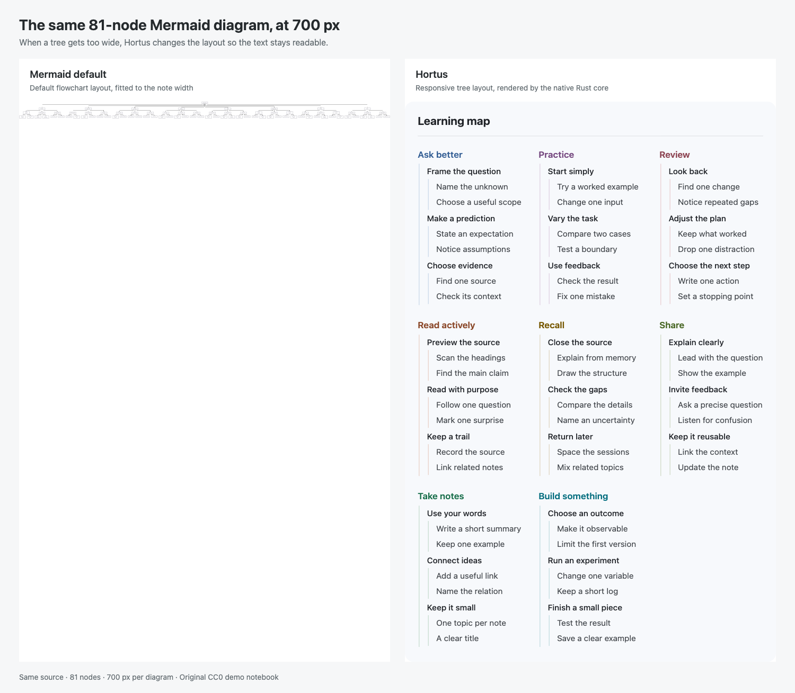
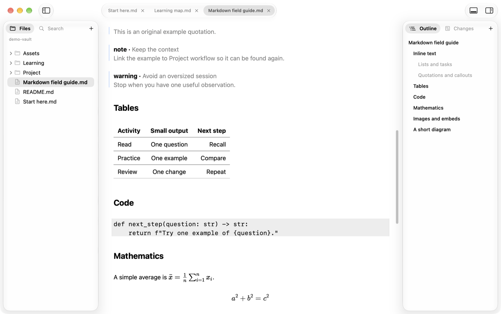
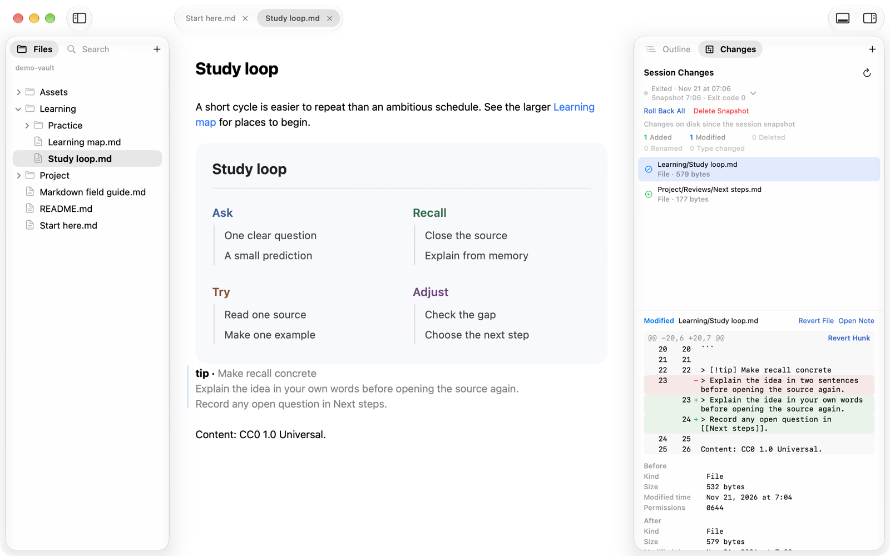
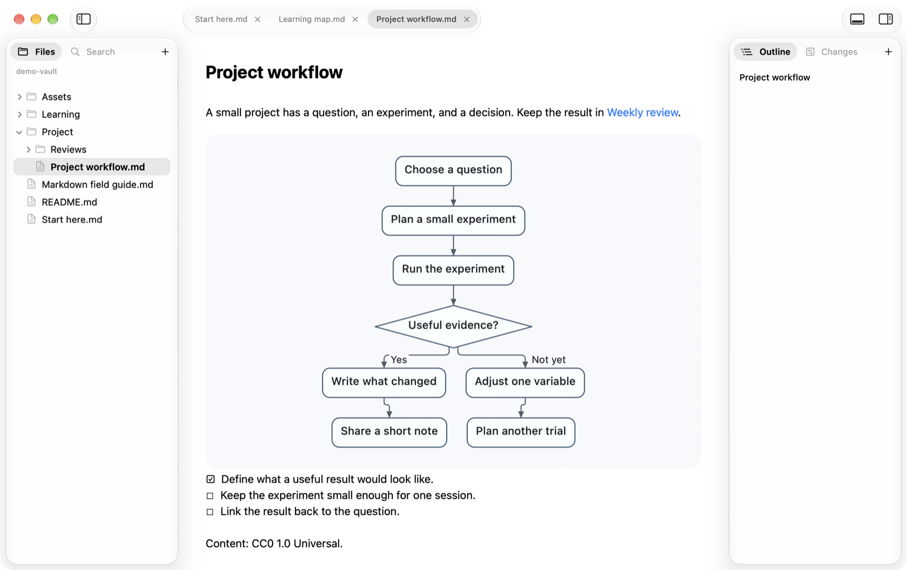

<h1>Hortus</h1>
<p><strong><a href="README.zh-CN.md">简体中文</a></strong></p>

Hortus is a cross-platform native Markdown knowledge viewer built for reading alongside AI agents — on **macOS 26.0+**, **Linux (GTK4)**, **Android**, and **iOS**, sharing a single Rust core with zero WebView. Open your notes folder directly, run command-line agents in a built-in terminal after an automatic full-vault snapshot, connect external agents over the bundled offline CLI or MCP server, review and roll back changes in place, and read six native Mermaid diagram types and LaTeX math without leaving the page.



[](https://github.com/groundgrounder/Hortus/releases)

## Why Hortus

Most note apps are built around typing. As agents draft, organize, and update more of your notes, you spend more time reading, verifying diffs, and keeping large diagrams legible. Hortus puts reading first, snapshots your vault before an agent runs, exposes your knowledge graph over offline CLI and MCP, and keeps editing one keystroke away across desktop and mobile.

| | Typical write-first note app | Hortus |
|---|---|---|
| Opening a note | Opens in an editor | Opens in a reading view with centered comfortable column width; `⌘E` / `Ctrl+E` switches to editing |
| Working with an agent | A plugin, or a terminal in another window | Built-in shell and multi-profile agent tabs at the vault root, custom command launch dialog, safe path/selection sending, plus bundled `hortus` CLI and `hortus mcp` |
| Safety net for agent edits | Manual Git commits or separate backups | Automatic full-vault snapshot before launch; review diffs and roll back a hunk, file, or session |
| Large Mermaid diagrams | Scaled down to fit, or scrolled sideways | Six native diagram types laid out in Rust and drawn natively, clickable `[[wikilinks]]`, Focus Mode, and SVG/PNG/PDF export |
| Runtime and footprint | Often a web app with a bundled browser engine | Native UIs (AppKit/SwiftUI, GTK4/libadwaita, Jetpack Compose, SwiftUI iOS) on one Rust core; 22.1 MiB installed on macOS (including CLI), 1 process |
| Your notes folder | Often stores app state and settings too | Holds only your files; settings live in `~/.config/hortus` and snapshots/caches in system directories |

## Features

### 1. Reading, full embeds, and knowledge graph

<picture>
  <source media="(prefers-color-scheme: dark)" srcset="docs/images/workspace-reading-dark.png">
  
</picture>

- **Native reading, centered column & LaTeX math.** Headings, lists, interactive tasks, quotes, callouts, footnotes, code blocks, aligned tables (with horizontal scroll for wide tables), and images render natively inside a centered comfortable column width on widescreen displays, with Markdown markers and comments (`<!-- … -->`, `%% … %%`) hidden. YAML frontmatter displays as compact properties. Inline (`$…$`) and display (`$$…$$`) LaTeX formulas typeset natively via RaTeX and bundled KaTeX fonts, preserve raw `$`/`$$` source on copy, support accessibility in reading order, and report syntax errors in place.
- **Full note & diagram embeds.** `![[Note]]`, `![[Note#Heading]]`, `![[Note|Alias]]`, and standalone `![[diagram.mmd]]` render inline as native embedded cards (preserving Markdown, math, images, Mermaid interactions, and nested links) with automatic cycle detection and a 3-level nesting guard.
- **Knowledge graph & instant lookup.** Click `[[wikilinks]]` (including heading anchors) and `#tags` directly in reading view. Inspect incoming references in **Backlinks** (including Mermaid node links and embeds), filter hierarchical `#tags` in **Tags**, follow active headings in **Outline**, open by title or path with Quick Open (`⌘P` / `Ctrl+P`), and run live full-text **Search** (`⇧⌘F` / `Ctrl+Shift+F`).

### 2. Built for AI agents

<picture>
  <source media="(prefers-color-scheme: dark)" srcset="docs/images/changes-review-dark.png">
  
</picture>

- **Built-in terminal & safe context sending.** Press `⌃\`` (`Ctrl+\`` on Linux) to open the built-in terminal at the vault root (`HORTUS_VAULT` set and bundled `hortus` added to `PATH` automatically), open additional shells or isolated agent tabs with Nerd Font fallback and custom monospace fonts, and send the active note's quoted relative path (`⌃⌘L`) or current reading/editing selection (`⇧⌃⌘L`) via sanitized bracketed paste — never auto-executing Enter.
- **Full-vault snapshots, diff review & rollback.** Before an agent launches, Hortus captures a full-vault snapshot (APFS/reflink copy-on-write where supported, keeping attachments and permissions, skipping `.git`, never following symlinks) and refuses to launch if snapshotting fails. External edits refresh open notes in place; review line-level hunks, renames, and metadata in **Changes** and roll back a single hunk, file, or entire session with digest verification.
- **Multi-profile agents (`[[agent.profiles]]`), custom commands & discovery.** **Settings → Agent** scans your login shell `PATH` for installed CLIs (`omp`, `codex`, `claude`, `gemini`, `opencode`, `aider`, `goose`) without executing any binary, manages multiple named agent profiles (`[[agent.profiles]]`) alongside a one-off **Custom Command** launch dialog, and lets you customize the built-in `{guide}` (also readable via `hortus guide`).
- **Bundled `hortus` CLI & offline MCP Server (`hortus mcp`).** macOS bundles `Contents/Helpers/hortus` inside `Hortus.app` (with one-click `~/.local/bin/hortus` symlink installation and MCP snippet copy in **Settings → Agent**), and standalone `hortus-cli-1.0.0-arm64.tar.gz` is also available. Query any vault offline as structured JSON with `hortus search`, `backlinks`, `links`, `tags`, `outline`, `orphans`, `broken-links`, `mermaid check`, `mermaid render`, and `guide`, or connect any MCP-compatible agent over stdio:

```json
{
  "mcpServers": {
    "hortus": {
      "command": "hortus",
      "args": ["mcp", "--vault", "/path/to/your/vault"]
    }
  }
}
```

`hortus mcp` exposes 9 read-only tools (`hortus_search`, `hortus_backlinks`, `hortus_links`, `hortus_tags`, `hortus_outline`, `hortus_orphans`, `hortus_broken_links`, `hortus_mermaid_check`, `hortus_guide`) and the `hortus://guide` resource with zero disk writes and zero network access.

### 3. Native Mermaid engine

<picture>
  <source media="(prefers-color-scheme: dark)" srcset="docs/images/flowchart-dark.png">
  
</picture>

- **Six native diagram types, zero WebView.** Parsed and laid out identically in Rust across every platform and the CLI, then drawn natively:
  - **Mindmaps & tree flowcharts:** responsive balanced columns at body text size with per-diagram persisted branch folding.
  - **General flowcharts:** branches, merges, loops, long chains, multi-root graphs, node shapes, edge labels, `classDef` styles, top-level subgraphs, and `~~~` ordering links with orthogonal routing.
  - **Sequence diagrams (`sequenceDiagram`):** participants, control blocks, notes, activations, and mirrored bottom headers on tall diagrams.
  - **State diagrams (`stateDiagram-v2` / `stateDiagram`):** start/end, composite states, concurrent regions, fork/join, choice, notes, and bidirectional or self-loop transitions.
  - **Class diagrams (`classDiagram`):** three-section UML cards, generics, stereotypes, visibility markers, `namespace` containers, all 8 relation types with cardinalities, and notes.
  - **Entity-relationship diagrams (`erDiagram`):** typed three-column attributes with `PK`/`FK`/`UK` badges, full Crow's Foot cardinalities, solid/dashed relations, and self-relations.
- **In-diagram `[[wikilinks]]`, source linking & Focus Mode (`⇧⌘D`).** Click `[[Note]]`, `[[Note#Heading]]`, or `[[Note|Alias]]` inside diagram nodes to navigate directly (and track references in Backlinks); `⌘-click` (or context menu) jumps to Mermaid source without relayout; open Focus Mode (`⇧⌘D`) for 25%–400% vector zoom, pan, minimap, node search, and cached per-diagram viewports.
- **Native export & standalone `.mmd` files.** Export any diagram directly from the laid-out scene to **SVG**, **2× Retina PNG**, or **vector PDF**, or render/check `.md` and `.mmd` files offline via `hortus mermaid check` and `hortus mermaid render`. Unsupported diagram types stay visible as source.

### 4. Four native apps, editing, files, and local-first privacy

- **Desktop (macOS & Linux).** Full multi-window workspace with dockable tool tabs (Files, Search, Outline, Backlinks, Tags, Changes, Shell, Agent), styled Markdown editing (`⌘E` / `Ctrl+E`) with `[[` wikilink completion, folder/note rename with vault-wide link updates, atomic saving that preserves file metadata, and two-way comment-preserving `~/.config/hortus/config.toml` sync.
- **Mobile (Android & iOS).** Native Jetpack Compose (Android) and SwiftUI (iOS / iPadOS) apps sharing the same Rust core for local Markdown reading, editing, full embeds, knowledge graph navigation, LaTeX math, and all six interactive Mermaid diagram types with pinch-zoom Focus Mode and export — designed to open synced local folders with zero internet permission or telemetry.
- **Local-first privacy.** Open any ordinary Markdown folder directly. Completely offline with zero networking or telemetry, in English and Simplified Chinese, following light and dark appearance.

## Performance

Measured on an Apple M3 MacBook Air (macOS 27.2.1) using the original [CC0 demo vault](fixtures/demo-vault/README.md); each figure is the median of five runs. See `tools/compare-obsidian.py` for the measurement setup.

| Metric | Hortus 1.0.0 (macOS) |
|---|---|
| Installed size (`du`, including bundled `hortus` CLI) | 22.1 MiB |
| Warm launch to note title | ~0.9 s (888 ms) |
| Memory with 81-node demo diagram open | ~137 MiB |
| Processes | 1 native process |

## Install

### macOS (Apple Silicon)

Requires **macOS 26.0 or later on Apple Silicon**. Version 1.0.0 uses ad-hoc signing and is not notarized.

1. Download `Hortus-1.0.0-arm64.dmg` from [Releases](https://github.com/groundgrounder/Hortus/releases), open it, and drag Hortus into Applications.
2. Open Hortus. macOS may block the first launch because it cannot verify the developer. Choose either method below to allow this copy:

**System Settings:** After the blocked attempt, click **Done**, open **System Settings → Privacy & Security**, find the message about Hortus, and click **Open Anyway**. Follow the confirmation and authentication prompts, then launch Hortus again if needed.

**Terminal:** After copying the app into Applications, run:

```sh
xattr -dr com.apple.quarantine /Applications/Hortus.app
open /Applications/Hortus.app
```

- **Bundled or standalone CLI:** Inside Hortus, open **Settings → Agent** to install a `~/.local/bin/hortus` symlink pointing to the bundled `Contents/Helpers/hortus` binary, or download the standalone `hortus-cli-1.0.0-arm64.tar.gz` archive from [Releases](https://github.com/groundgrounder/Hortus/releases).

### Linux (x86_64)

Native GTK4 + libadwaita + VTE4 desktop app and `hortus` CLI:

- **Nix flake:** `nix run github:groundgrounder/Hortus` (or `nix profile install github:groundgrounder/Hortus`)
- **Packages:** Download the `.deb` (Debian/Ubuntu), `.rpm` (Fedora/RHEL), or `.tar.gz` bundle from [Releases](https://github.com/groundgrounder/Hortus/releases).

### Android (arm64-v8a)

Download the signed Release APK `Hortus-1.0.0-android-arm64.apk` from [Releases](https://github.com/groundgrounder/Hortus/releases) and install it on Android 10+ (API 29+). Grant folder access to open a local vault synced via your preferred external sync tool (zero `INTERNET` permission).

### iOS / iPadOS (arm64, sideload)

Download `Hortus-1.0.0-ios-unsigned.ipa` from [Releases](https://github.com/groundgrounder/Hortus/releases) (iOS / iPadOS 18.0+) and sign/install with your own Apple ID using a sideloading tool such as AltStore, SideStore, or Sideloadly.

## Architecture

A shared Rust workspace (`crates/`) handles vault watching, file operations, atomic saving, Markdown semantics and embeds, link/tag graph indexing, native layout for six Mermaid diagram types, RaTeX math, full-text search, session snapshots/diff/rollback, configuration, and offline read-only CLI and MCP queries. Four native apps (`apps/macos/`, `apps/linux/`, `apps/android/`, `apps/ios/`) draw directly on platform toolkits with zero WebView. The diagram below was laid out and rendered by Hortus 1.0.0 itself with `hortus mermaid render`.

<picture>
  <source media="(prefers-color-scheme: dark)" srcset="docs/images/architecture-dark.png">
  
</picture>

<details>
<summary>Mermaid source</summary>



</details>

```mermaid
flowchart TD
  app[Hortus 1.0.0]
  core[Rust core]
  clients[Native apps]
  app --> core
  app --> clients
  vault[Vault: scan, watch, file ops, atomic save]
  doc[Documents: Markdown semantics and embeds]
  links[Links: wikilinks, backlinks, tags, rename]
  diagram[Diagrams: 6 Mermaid types, links, SVG/PNG/PDF]
  math[Math: native LaTeX via RaTeX]
  search[Search and Quick Open]
  history[History: snapshots, diff, rollback]
  cli[CLI and MCP: offline read-only JSON]
  config[Settings, agent profiles and guide]
  core --> vault
  core --> doc
  core --> links
  core --> diagram
  core --> math
  core --> search
  core --> history
  core --> cli
  core --> config
  mac[macOS: AppKit, SwiftUI, TextKit 2, SwiftTerm]
  linux[Linux: GTK4, libadwaita, VTE4, Cairo/Pango]
  android[Android: Jetpack Compose, Canvas, UniFFI]
  ios[iOS: SwiftUI, Core Text, Core Graphics]
  clients --> mac
  clients --> linux
  clients --> android
  clients --> ios
```

## Known issues

- macOS 1.0.0 downloads are ad-hoc signed. Updating or re-downloading the app may require first-launch approval again.
- When a macOS terminal session accesses protected folders such as Documents, macOS requests permission on behalf of Hortus. App updates may require re-granting access in **Privacy & Security → Files & Folders**.
- iOS builds are distributed as unsigned `.ipa` archives for sideloading and require signing with your own Apple ID.
- Mermaid support covers mindmaps, tree and general flowcharts (including top-level subgraphs), sequence diagrams, state diagrams (`stateDiagram-v2` / `stateDiagram`), class diagrams (`classDiagram`), and entity-relationship diagrams (`erDiagram`). Unsupported diagram types (such as `gantt` or `pie`) stay visible as source.

## Roadmap

- Classic radial/horizontal mindmap view mode and semantic zoom for extra-large diagrams.
- Additional Mermaid diagram refinements and cross-platform editing polish.
- Vault-level graph exploration and richer offline CLI / MCP workflows.

<details>
<summary>Continuous integration</summary>

CI runs on pull requests, pushes to `main`, and manual dispatches. Ubuntu checks Rust formatting, Clippy, workspace tests, and math-check tests. macOS CI builds the macOS app with warnings treated as errors, runs the Swift tests, and checks the public tree and app bundle.

CI does not create release packages, notarize, publish, or replace local release, real-window, TCC, or performance validation. Job logs remain available in each Actions run.

</details>

## License

- `crates/` and `tools/` are licensed under either the MIT license ([LICENSE-MIT](LICENSE-MIT)) or the Apache License 2.0 ([LICENSE-APACHE](LICENSE-APACHE)), at your option.
- `apps/` is licensed under GPL-3.0-only ([apps/LICENSE](apps/LICENSE)).
- The CC0 notices in `fixtures/vault-sample/` continue to apply to those sample notes. The original [demo vault](fixtures/demo-vault/LICENSE.txt) is also CC0.
- Licenses for bundled open-source software and KaTeX fonts (SIL OFL 1.1) are listed in each app's **Third-Party Notices** (`ThirdPartyNotices.txt`).

Contributions are accepted under the license of the directory they modify. No CLA is required.

If Hortus is useful to you, please give it a [star](https://github.com/groundgrounder/Hortus).
