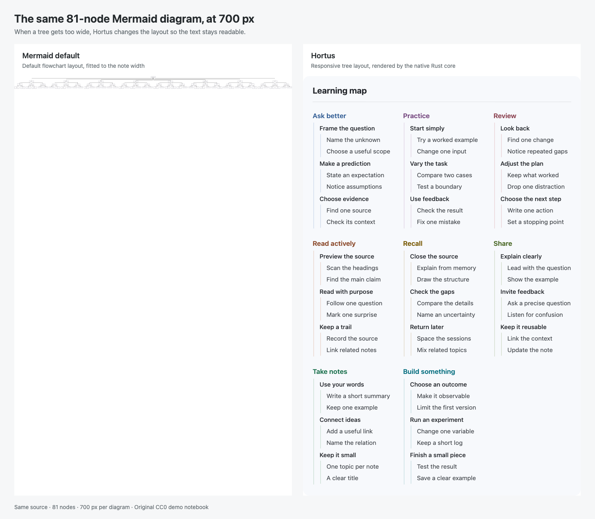

<h1>Hortus</h1>
<p><strong><a href="README.zh-CN.md">简体中文</a></strong></p>



Hortus is a native Markdown knowledge viewer that keeps large Mermaid trees readable and refreshes your notes as agents write them.

[](https://github.com/groundgrounder/Hortus/releases)

## Why Hortus

- **Large diagrams stay readable.** Trees that outgrow the note width flow into columns while keeping their text at a readable size. The comparison above uses the same 81-node source at 700 px per panel.
- **A native Mac app.** Native text and drawing, with no WebView or Electron. No runtime networking or telemetry.
- **Read first, write with an agent.** Read your knowledge vault while an agent works on its Markdown files in a terminal. External changes refresh in place; press ⌘E when you want to edit a note yourself.
- **Your notes are ordinary files.** Open a Markdown folder directly, including an existing Obsidian vault. Wiki links, embeds, tasks, callouts and frontmatter are supported; application state stays outside the note folder.

Try the original [CC0 demo vault](fixtures/demo-vault/README.md). On an Apple M3 MacBook Air (macOS 27.0.1), Hortus 0.1.0 takes 9.5 MiB on disk, shows the note about 0.4 s after launch, and uses about 130 MiB of memory with the demo diagram open, as one process. Each figure is the median of five runs; see `tools/compare-obsidian.py` for the method.

## Install

Requires **macOS 27 or later and an Apple Silicon Mac**. Version 0.1.0 uses ad-hoc signing and is not notarized.

1. Download `Hortus-0.1.0-arm64.dmg` from [Releases](https://github.com/groundgrounder/Hortus/releases), open it, and drag Hortus into Applications.
2. Open Hortus. macOS may block the first launch because it cannot verify the developer. Choose either of the following ways to allow this copy:

**System Settings:** After the blocked attempt, click **Done**, open **System Settings → Privacy & Security**, find the message about Hortus, and click **Open Anyway**. Follow the confirmation and authentication prompts, then launch Hortus again if needed.

**Terminal:** After copying the app into Applications, run:

```sh
xattr -dr com.apple.quarantine /Applications/Hortus.app
open /Applications/Hortus.app
```

Both ways were tested on macOS 27.0.1. The wording of the system prompt may differ on other macOS versions.

## Known issues

- The 0.1.0 download is ad-hoc signed. A replacement download or update may require first-launch approval again.
- When the terminal accesses protected folders such as Documents, macOS may request permission. App updates may require you to grant access again in **Privacy & Security → Files & Folders**.
- Mermaid support currently focuses on mindmaps and tree-shaped flowcharts. Unsupported diagrams remain visible as source.

## Roadmap

- **0.1.1:** notarization and evaluating support for macOS 26.
- Richer links and backlinks.
- Review and undo agent changes.
- Linux.

## License

- `crates/` and `tools/` are licensed under either the MIT license ([LICENSE-MIT](LICENSE-MIT)) or the Apache License 2.0 ([LICENSE-APACHE](LICENSE-APACHE)), at your option.
- `apps/` is licensed under GPL-3.0-only ([apps/LICENSE](apps/LICENSE)).
- The CC0 notices in `fixtures/vault-sample/` continue to apply to those sample notes. The original [demo vault](fixtures/demo-vault/LICENSE.txt) is also CC0.
- The licenses of the open source software included in the app are listed in **About Hortus → Third-Party Licenses** (`Hortus.app/Contents/Resources/ThirdPartyNotices.txt`, generated by `tools/third-party-notices.py`).

Contributions are accepted under the license of the directory they modify. No CLA is required.

If Hortus is useful to you, please give it a [star](https://github.com/groundgrounder/Hortus).
