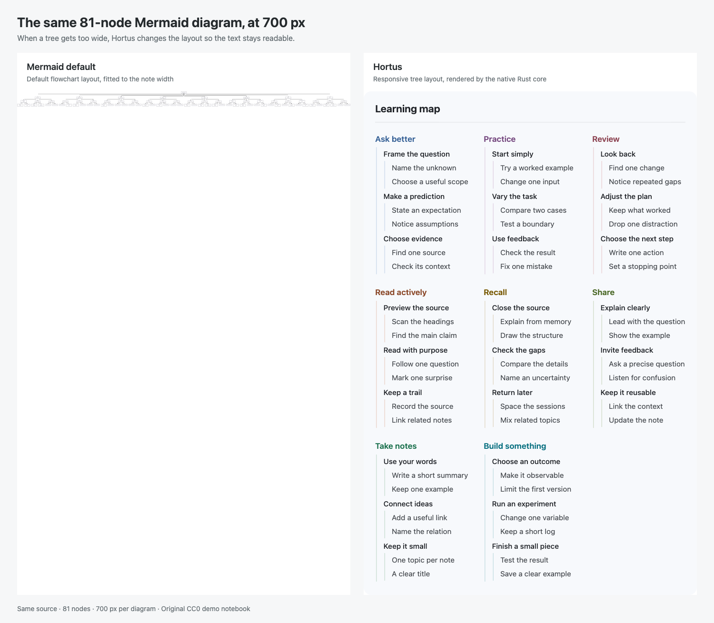
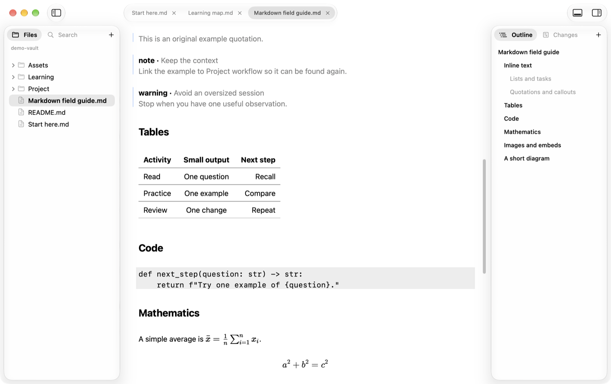
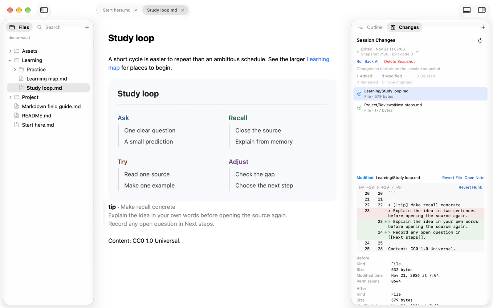

<h1>Hortus</h1>
<p><strong><a href="README.md">English</a></strong></p>

Hortus 是一款面向阅读与 AI Agent 协作的原生 macOS Markdown 知识库应用。直接打开笔记文件夹，在内置终端启动 Agent 前自动完成全库快照，通过离线只读 CLI 与 MCP 把知识图谱暴露给外部 Agent，改动原地刷新并支持在应用内审阅 diff 与安全回滚；6 大原生 Mermaid 图型和 LaTeX 公式也能在同一页清晰阅读。



[](https://github.com/groundgrounder/Hortus/releases)

## 为什么做 Hortus

大多数笔记软件围绕打字设计。当越来越多笔记由 Agent 起草、归类和更新时，人们把更多时间花在阅读、核对改动，以及看清整张结构图上。Hortus 把阅读放在第一位，在 Agent 运行前先备份整座笔记库，用离线 CLI 和 MCP 向 Agent 开放只读知识图谱，需要自己修改时按一下键即可进入编辑。

| | 常见的写优先笔记软件 | Hortus |
|---|---|---|
| 打开一篇笔记 | 直接进入编辑器 | 默认打开阅读视图；按 `⌘E` 切到编辑 |
| 和 Agent 配合 | 装插件，或在另一个窗口开终端 | 库根目录内置 Shell 与 Agent 标签（`⌃\``）、一键发送路径（`⌃⌘L`）或选区（`⇧⌃⌘L`），外加离线 CLI 与 `hortus mcp` |
| Agent 改动兜底 | 手动执行 Git 提交或额外备份 | 启动前自动完成全库快照；支持在应用内查看 diff 并按 hunk、单文件或整场回滚 |
| 大幅 Mermaid 图表 | 整体缩小，或左右滚动 | Rust + Core Graphics 原生渲染 6 大图型、支持图内 `[[双链]]`、专注模式（`⇧⌘D`）与 SVG/PNG/PDF 导出 |
| 构建方式与占用 | 常见为网页应用并自带浏览器内核 | 原生 Swift（AppKit 与 SwiftUI）搭配 Rust 内核；安装占用 18.5 MiB、单个进程 |
| 你的笔记文件夹 | 常常同时存放应用状态与设置 | 只放你自己的文件；设置放在 `~/.config/hortus`，快照放在 Application Support |

## 功能

### 1. 阅读、完整内嵌与知识图谱

<picture>
  <source media="(prefers-color-scheme: dark)" srcset="docs/images/workspace-reading-dark.png">
  
</picture>

- **原生阅读与 LaTeX 公式。** 标题、列表、可勾选任务、引用、callout、脚注、代码块、列对齐表格（超宽表格区域内横向滚动）与快速查看图片均按阅读排版显示，隐藏 Markdown 标记符与注释（`<!-- … -->`、`%% … %%`）；YAML frontmatter 以紧凑属性行展示。行内（`$…$`）与块级（`$$…$$`）LaTeX 公式由 RaTeX 与 Core Text 原生排版，复制还原原始 `$`/`$$` 源码，支持 VoiceOver 顺序朗读，出错时在原处提示原因而不影响整篇笔记。
- **完整笔记与独立图内嵌。** `![[笔记]]`、`![[笔记#章节]]`、`![[笔记|别名]]` 与独立图 `![[diagram.mmd]]` 在阅读视图中渲染为原生嵌入卡片，完整支持正文、公式、图片、Mermaid 交互与嵌套链接，内置循环检测与 3 层嵌套上限保护。
- **知识图谱与即时定位。** 阅读视图直接点击 `[[双链]]`（含标题锚点）与 `#标签`；在**反链**面板查看全部引用来源（含 Mermaid 图节点双链与嵌入），在**标签**面板按层级筛选 `#标签`，在**大纲**面板按标题跳转，使用快速打开（`⌘P`）与实时全文**搜索**（`⇧⌘F`）秒级定位内容。

### 2. 面向 AI Agent 协作

<picture>
  <source media="(prefers-color-scheme: dark)" srcset="docs/images/changes-review-dark.png">
  
</picture>

- **内置终端与安全发送上下文。** 按 `⌃\`` 在库根目录打开内置终端（自动注入 `HORTUS_VAULT`），按 `⌘T` 新建普通 Shell 或 `⌥⌘T` 启动独立 Agent 标签，支持 Nerd Font 图标回退与自定义等宽字体。按 `⌃⌘L` 发送当前笔记的安全引用路径，或按 `⇧⌃⌘L` 将阅读/编辑视图选区经清洗后的 bracketed paste 发送到终端，绝不自动按回车执行。
- **全库快照、改动审阅与安全回滚。** 启动 Agent 前自动为整座笔记库拍摄快照（APFS 优先 clonefile 写时复制，覆盖附件与权限，跳过 `.git` 且不跟随符号链接）；快照未完整建立时拒绝启动。外部改动原地刷新当前阅读位置，在 **Changes** 面板可逐 hunk 查看 diff 与重命名/元数据，支持按 hunk、单文件或整场会话校验摘要后安全回滚。
- **Agent 自动发现与内置指南。** **设置（`⌘,`）→ Agent** 在不执行任何程序的前提下扫描登录 shell `PATH` 与常见 macOS 目录，发现已安装 CLI（`omp`、`codex`、`claude`、`gemini`、`opencode`、`aider`、`goose`）并一键填入启动模板，同时支持自定义内置 `{guide}`（外部工具可运行 `hortus guide` 获取）。
- **离线只读 CLI 与 MCP Server（`hortus mcp`）。** 可用 `hortus search`、`backlinks`、`links`、`tags`、`outline`、`orphans`、`broken-links`、`mermaid check`、`mermaid render` 与 `guide` 离线查询结构化 JSON，也可通过 stdio 接入任意支持 MCP 的 Agent：

```json
{
  "mcpServers": {
    "hortus": {
      "command": "hortus",
      "args": ["mcp", "--vault", "/path/to/your/vault"]
    }
  }
}
```

`hortus mcp` 暴露 9 个只读工具（`hortus_search`、`hortus_backlinks`、`hortus_links`、`hortus_tags`、`hortus_outline`、`hortus_orphans`、`hortus_broken_links`、`hortus_mermaid_check`、`hortus_guide`）与只读资源 `hortus://guide`，零写盘、零联网。

### 3. 原生 Mermaid 引擎

<picture>
  <source media="(prefers-color-scheme: dark)" srcset="docs/images/flowchart-dark.png">
  
</picture>

- **6 大主流图型原生渲染，零 WebView。** 解析与布局完全在 Rust 内核完成，平台端使用 Core Text 与 Core Graphics 矢量绘制：
  - **思维导图与树形流程图：** 超宽时自动排成均衡多栏并维持正文字号，点击分支可折叠/展开并按图持久记忆。
  - **一般流程图：** 支持分支、汇合、回路、长链、多根、常见节点形状、边标签、`classDef` 样式、顶层子图与 `~~~` 不可见连线，正交圆角走线避让节点。
  - **时序图（`sequenceDiagram`）：** 支持参与者、控制块、注释、激活条与长图底部镜像表头。
  - **状态图（`stateDiagram-v2` / `stateDiagram`）：** 支持起止伪状态、复合状态、并发区域、fork/join、choice、注释以及双向与自环转换。
  - **类图（`classDiagram`）：** 支持三段式 UML 卡片、泛型与构造型、可见性标记、`namespace` 分组、8 类关系与基数及便签。
  - **实体关系图（`erDiagram`）：** 支持三列属性、`PK`/`FK`/`UK` 徽标、完整 Crow's Foot 鸦脚基数、实/虚线关系与自关联。
- **图内 `[[双链]]`、双向定位与专注模式（`⇧⌘D`）。** 直接点击图节点内的 `[[笔记]]`、`[[笔记#章节]]` 或 `[[笔记|别名]]` 跳转（同时计入反链，兼容阅读、编辑、嵌入卡片与专注模式）；`⌘` 点击或右键无重排跳回源码；专注模式（`⇧⌘D`）提供 25%–400% 矢量缩放、平移、小地图、`⌘F` 节点搜索并按图缓存视口。
- **原生导出与独立 `.mmd` 文件。** 通过右键菜单或专注模式顶栏原生导出 **SVG**、**2× Retina PNG** 或**矢量 PDF**，也可用 `hortus mermaid check` / `render` 离线校验与渲染 `.md` 和 `.mmd` 文件；暂不支持的图型保留源码显示。

### 4. 编辑、文件管理、多窗口与本地隐私

- **样式化源码编辑（`⌘E`）。** 基于 TextKit 2 保留淡色 Markdown 标记符并呈现标题、强调、链接与 callout 样式；输入 `[[` 弹出原生单步可撤销补全，`⌘` 点击链接跳转，完整承接系统输入法、撤销/重做与查找替换（`⌘F`、`⌥⌘F`），再按 `⌘E` 回到阅读视图同一位置。
- **库内文件管理与原子保存。** 支持在侧栏或菜单中新建笔记/文件夹、重命名单篇笔记或**整个文件夹**（自动预览并同步更新库内笔记、嵌入与显式路径附件引用，保护未保存标签页）以及移到废纸篓。停止输入 1 秒后自动保存，按 `⌘S`/切换标签/失焦立即保存；原子替换保留创建时间、Finder 标签、扩展属性、权限、换行符与 BOM，并支持冲突处理与恢复稿。
- **多窗口、自由停靠与纯本地隐私。** 支持多库独立窗口与同库标签页拖出建窗；文件、搜索、大纲、反链、标签、Changes、Shell 与 Agent 共用一层可停靠工具标签，可在左侧栏（`⌃⌘S`）、右侧栏（`⌥⌘I`）与底部面板（`⌘J`）间自由拖拽。直接打开普通 Markdown 文件夹或 Obsidian 库（忽略 `.obsidian`）；**设置（`⌘,`）** 与 `~/.config/hortus/config.toml` 双向保注释同步；完全离线零遥测，支持简体中文与英文并随系统深浅外观切换。

## 实测数据

在 Apple M3 MacBook Air（macOS 27.2.1）上使用原创 [CC0 演示库](fixtures/demo-vault/README.md) 测量，每项取五次测量的中位数，测法见 `tools/compare-obsidian.py`。

| 指标 | Hortus 0.5.0 |
|---|---|
| 安装占用（`du`） | 18.5 MiB |
| 热启动到显示笔记 | 约 0.4 s |
| 打开 81 节点演示大图内存 | 约 145 MiB |
| 进程数 | 1 个原生进程 |

## 安装

需要 **macOS 27 或更高版本、Apple 芯片 Mac**。0.5.0 使用 ad-hoc 签名，尚未公证。

1. 从 [Releases](https://github.com/groundgrounder/Hortus/releases) 下载 `Hortus-0.5.0-arm64.dmg`，打开后把 Hortus 拖到“应用程序”。
2. 打开 Hortus。macOS 可能因无法验证开发者而阻止首次启动，可用下面任一种方式放行这个副本：

**系统设置：** 尝试打开被阻止后，点 **完成**，进入 **系统设置 → 隐私与安全**（有的版本叫“隐私与安全性”），找到 Hortus 的提示，点 **仍要打开**。弹出“打开‘Hortus’？”时再点 **仍要打开**，然后按提示验证身份；如有需要，再次启动 Hortus。

**终端：** 将应用复制到“应用程序”后运行：

```sh
xattr -dr com.apple.quarantine /Applications/Hortus.app
open /Applications/Hortus.app
```

两种方式均已在 macOS 27.2 上验证。其他系统版本上的提示文字可能不同。

## 架构

Rust 工作区（`crates/`）负责笔记库监听、文件管理、原子保存、Markdown 语义与完整内嵌、双链与标签知识图谱、6 大 Mermaid 图型原生布局、RaTeX 公式、全文搜索、会话快照/diff/回滚、配置管理与离线只读 CLI 及 MCP 服务；macOS 应用（`apps/macos/`）基于 AppKit 与 SwiftUI 用 Swift 编写，通过 UniFFI 调用内核。下面这张图由 Hortus 0.5.0 自己用 `hortus mermaid render` 排版与绘制。

<picture>
  <source media="(prefers-color-scheme: dark)" srcset="docs/images/architecture-zh-dark.png">
  
</picture>

<details>
<summary>Mermaid 源码</summary>


</details>

## 已知问题

- 0.5.0 下载包采用 ad-hoc 签名。重新下载或更新应用后，可能需要再次放行首次启动。
- 终端访问“文稿”等受保护目录时，macOS 可能弹出授权提示。应用更新后可能需要在 **隐私与安全 → 文件与文件夹** 中重新授权。
- Mermaid 原生支持 mindmap、树形与一般 flowchart（含顶层子图）、时序图（`sequenceDiagram`）、状态图（`stateDiagram-v2` / `stateDiagram`）、类图（`classDiagram`）与实体关系图（`erDiagram`）；暂不支持的图型（如 `gantt`、`pie`）保持显示源码。

## 路线图

- 原生 Linux 桌面版（GTK4 + libadwaita + VTE），与 macOS 共用同一套 Rust 内核，提供 `deb`、`rpm` 与 Nix flake 打包。
- macOS 与 Linux 双端打磨并发布 `1.0.0`。
- `1.0.0` 之后推进 iOS 阅读端与更多图表体验增强。

<details>
<summary>持续集成</summary>

CI 在拉取请求、推送 `main` 和手动触发时运行。Ubuntu 24.04 检查 Rust 格式、Clippy、工作区测试和公式检查器测试。GitHub 的公共预览 `xcode-27` 镜像以警告即错误构建 macOS 应用、运行 Swift 测试，并检查公开树和应用包；官方镜像当前记录为 macOS 27.0.1、Xcode 27.1 和 Swift 6.4。

CI 不生成发布包、不公证或发布，也不替代本机发布、真实窗口、TCC 或性能验收。任务日志保留在每次 Actions 运行中。

</details>

## 许可证

- `crates/` 和 `tools/` 可任选 MIT（[LICENSE-MIT](LICENSE-MIT)）或 Apache License 2.0（[LICENSE-APACHE](LICENSE-APACHE)）。
- `apps/` 使用 GPL-3.0-only（[apps/LICENSE](apps/LICENSE)）。
- `fixtures/vault-sample/` 中示例笔记原有的 CC0 声明继续有效。原创[演示库](fixtures/demo-vault/LICENSE.txt)同样采用 CC0。
- 应用里包含的开源软件及 KaTeX 字体（SIL OFL 1.1）的许可证列在 **关于 Hortus → 第三方许可证**（`Hortus.app/Contents/Resources/ThirdPartyNotices.txt`，由 `tools/third-party-notices.py` 生成）。

贡献按所修改目录的许可证接收，无需签署 CLA。

觉得 Hortus 有用，请点个 [star](https://github.com/groundgrounder/Hortus)。
