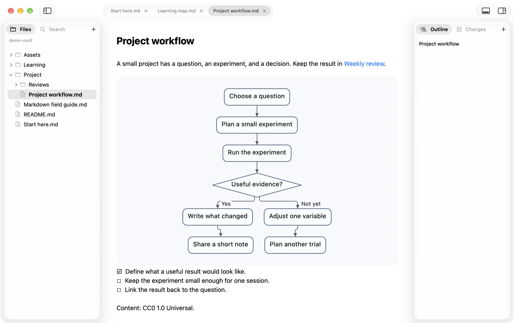
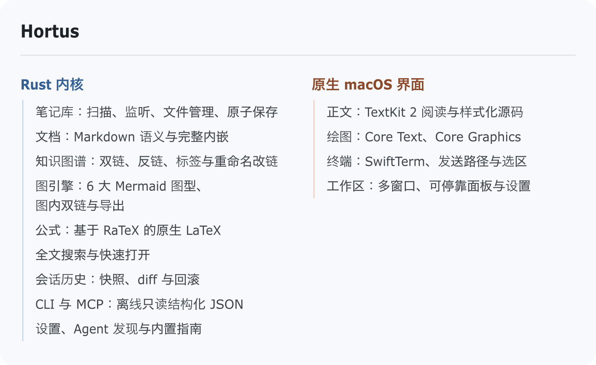
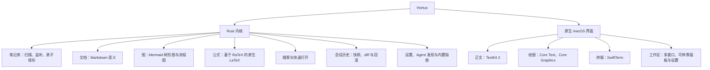

<h1>Hortus</h1>
<p><strong><a href="README.md">English</a></strong></p>

Hortus 是一款面向阅读与 AI Agent 协作的原生 macOS Markdown 知识库应用。直接打开笔记文件夹，在内置终端启动 Agent 前自动完成全库快照，改动会原地刷新并支持在应用内审阅 diff 与安全回滚；大幅 Mermaid 图表和 LaTeX 公式也能在同一页清晰阅读。


[](https://github.com/groundgrounder/Hortus/releases)

## 为什么做 Hortus

大多数笔记软件围绕打字设计。当越来越多笔记由 Agent 起草、归类和更新时，人们把更多时间花在阅读、核对改动，以及看清整张结构图上。Hortus 把阅读放在第一位，在 Agent 运行前先备份整座笔记库，需要自己修改时按一下键即可进入编辑。

| | 常见的写优先笔记软件 | Hortus |
|---|---|---|
| 打开一篇笔记 | 直接进入编辑器 | 默认打开阅读视图；按 `⌘E` 切到编辑 |
| 和 Agent 配合 | 装插件，或在另一个窗口开终端 | 在库根目录打开内置 Shell 与 Agent 标签（`⌃\``），改动原地刷新 |
| Agent 改动兜底 | 手动执行 Git 提交或额外备份 | 启动前自动完成全库快照；支持在应用内查看 diff 并按 hunk、单文件或整场回滚 |
| 大幅 Mermaid 图表 | 整体缩小，或左右滚动 | 树形图自动分栏保持正文字号，原生支持流程图、时序图与状态图，支持专注模式（`⇧⌘D`） |
| 构建方式与占用 | 常见为网页应用并自带浏览器内核 | 原生 Swift（AppKit 与 SwiftUI）搭配 Rust 内核；安装占用 18.0 MiB、单个进程 |
| 你的笔记文件夹 | 常常同时存放应用状态与设置 | 只放你自己的文件；设置放在 `~/.config/hortus`，快照放在 Application Support |

## 功能

### 阅读与原生 LaTeX 公式

<picture>
  <source media="(prefers-color-scheme: dark)" srcset="docs/images/workspace-reading-dark.png">
  
</picture>

- 标题、列表、任务列表、引用、callout、脚注、代码块、表格和本地图片均按阅读排版显示，隐藏 Markdown 标记符以及 HTML（`<!-- … -->`）和 `%% … %%` 注释；YAML frontmatter 以简洁的属性行展示。
- 行内（`$…$`）与块级（`$$…$$`）LaTeX 公式通过 RaTeX 与 Core Text 原生排版，支持嵌套在列表、引用、callout 与表格中，并跟随浅色与深色外观。选中复制会还原带 `$` 或 `$$` 的 LaTeX 源码，VoiceOver 按阅读顺序朗读，写法出错时在原处显示源码和原因，不影响整篇笔记渲染。
- 表格按笔记宽度排开并保留列对齐，超宽表格在表格区域内横向滚动；图片保持原比例，点击后用“快速查看”打开。
- 在阅读视图里直接勾选任务复选框即可写回文件；直接点击 `[[双链]]`（含标题定位）与 `#标签` 跳转或筛选，右键支持复制对应片段的 Markdown 源码，右侧“大纲”面板点击标题即可跳转。

### 与 Agent 安全协作

<picture>
  <source media="(prefers-color-scheme: dark)" srcset="docs/images/changes-review-dark.png">
  
</picture>

- 按 `⌃\`` 在当前笔记库根目录呼出内置终端（自动设置 `HORTUS_VAULT`），按 `⌘T` 新建普通 Shell，或新建独立 Agent 会话标签。终端支持 Nerd Font 图标回退与自定义等宽字体。
- 每次启动 Agent 前，Hortus 会先为整座笔记库建立完整快照（在 APFS 上优先使用 clonefile 写时复制），覆盖附件、权限与隐藏用户文件，自动跳过 `.git` 且不跟随符号链接；若快照未完整建立，Agent 不会启动。
- 在 **设置（`⌘,`）→ Agent** 中，Hortus 可在不执行任何目标程序的前提下扫描登录 shell `PATH` 与常见 macOS 目录，自动发现已安装的 CLI（`omp`、`codex`、`claude`、`gemini`、`opencode`、`aider`、`goose`），一键填入可执行路径与参数模板，并支持自定义内置 `{guide}` 指南（外部工具也可运行 `hortus guide` 获取）。从 Finder 或 Dock 启动时同样转发补强后的 `PATH`。
- Agent 或外部脚本可通过 `hortus` CLI 离线执行只读结构化 JSON 查询：`search`、`backlinks`、`links`、`tags`、`outline`、`orphans`、`broken-links`，以及 `mermaid check` / `render`。
- Agent 或外部脚本写入文件后，已打开的笔记原地刷新且保持当前阅读滚动位置。在 **Changes** 面板可按会话查看新增、修改、删除、重命名、二进制元数据和逐行 hunk diff，支持回滚单个 hunk、单个文件或整场会话（写入前校验当前文件摘要），并在 History 中清理已完成会话的旧快照。

### Mermaid 图表

<picture>
  <source media="(prefers-color-scheme: dark)" srcset="docs/images/flowchart-dark.png">
  
</picture>

- Mermaid 解析与布局在 Rust 内核完成，平台端采用 Core Text 与 Core Graphics 矢量绘制，任意窗口尺寸下都清晰锐利。
- 当 mindmap 或树形 flowchart 超出笔记宽度时，根节点变为标题，一级分支按高度均衡排成多栏，文字始终维持正文可读字号；拖拽窗口宽度时列数自动重排。点击任意分支可折叠或展开，折叠状态按图表持久记住。
- 一般 flowchart 支持分支、汇合、回路、长链、多根、常见节点形状、边标签、class 样式、顶层子图以及 `~~~` 不可见排序连线，采用正交走线避让节点与标签。
- 原生支持**时序图**（`sequenceDiagram`）与**状态图**（`stateDiagram-v2` / `stateDiagram`），覆盖参与者、控制块、注释、激活条、长图底部镜像表头，以及起止状态、复合状态、并发区域、fork/join、choice 与双向/自环转换。
- **源码与图双向定位及专注模式（`⇧⌘D`）**：在 Mermaid 源码中移动光标会同步高亮对应图元，按住 `⌘` 点击（或右键菜单）可无重排跳回源码；进入专注模式支持 25%–400% 矢量缩放、平移、小地图、`⌘F` 节点搜索，并按图表缓存视口状态。
- 暂不支持的图类型会保持显示 Mermaid 源码；可通过 `hortus mermaid check` 检查图表语法，或用 `hortus mermaid render` 离线导出 SVG、布局指标与语义场景 JSON。

### 编辑、文件管理与安全保存

- 按 `⌘E` 进入基于 TextKit 2 的样式化源码视图：Markdown 标记符以淡色显示，标题、强调、链接和 callout 保留样式；输入 `[[` 弹出原生双链补全，`⌘` 点击链接即可跳转，再按 `⌘E` 回到阅读视图的同一位置。
- 支持在文件树或菜单中直接新建笔记与文件夹、重命名（自动预览并同步更新库内反向引用）以及移到废纸篓，跨窗口同步标签页、撤销历史并保护未保存草稿。
- 打字、中文等输入法组合、撤销/重做以及查找替换（`⌘F`、`⌥⌘F`）均由原生文本系统承接；源码模式下按 `⌥⌘T` 一键对齐 Markdown 表格列。
- 停止输入一秒后自动保存，按 `⌘S`、切换标签页或窗口失焦时立即保存。保存仅替换文件正文，保留创建时间、Finder 标签、扩展属性、权限、换行符与 BOM。
- 当未保存编辑与磁盘外部改动冲突时，可选择采用磁盘版本、保留本地修改或另存为冲突副本；保存失败时保留恢复稿供后续恢复。

### 知识面板、多窗口工作区与查找

- 支持同时在多个独立窗口打开不同笔记库（再次打开已打开的库会前置原窗口），也可把标签页拖出窗口为同一个库新建独立窗口，保留未保存正文、选区与撤销历史；重启后自动恢复窗口、标签、阅读/编辑模式与面板布局。
- 文件、搜索、大纲、反链、标签、Changes、Shell 与 Agent 共用一层可停靠工具标签，可在左侧栏（`⌃⌘S`）、右侧栏（`⌥⌘I`）和底部面板（`⌘J`）之间自由拖拽分组，每组均带 `+` 菜单。
- **反链**面板汇总指向当前笔记的全部引用（含 Mermaid 图节点与嵌入）；**标签**面板按层级聚合 `#标签` 计数并支持即时筛选。
- 快速打开（`⌘P`）按标题与路径即时匹配笔记；全文搜索（`⇧⌘F`）高亮全部命中位置并随文件变动实时更新。

### 你的文件与设置

- 直接打开普通 Markdown 文件夹，也可直接打开已有的 Obsidian 库（自动忽略 `.obsidian`），可继续搭配 Git、脚本或其他编辑器共同使用。
- **设置窗口（`⌘,`）** 与 `~/.config/hortus/config.toml` 双向保注释同步，保留手工注释与未知配置项，并在检测到外部手工修改时提示冲突，避免静默覆盖。缓存放在 `~/Library/Caches/Hortus`，会话快照放在 `~/Library/Application Support/Hortus/agent-sessions/`。
- 完全离线运行，不联网、不采集遥测；界面支持简体中文与英文，随系统语言与浅色/深色外观自动切换。

## 实测数据

在 Apple M3 MacBook Air（macOS 27.2.1）上使用原创 [CC0 演示库](fixtures/demo-vault/README.md) 测量，每项取五次测量的中位数，测法见 `tools/compare-obsidian.py`。

| 指标 | Hortus 0.4.0 |
|---|---|
| 安装占用（`du`） | 18.0 MiB |
| 热启动到显示笔记 | 约 0.8 s |
| 打开 81 节点演示大图内存 | 约 150 MiB |
| 进程数 | 1 个原生进程 |

## 安装

需要 **macOS 27 或更高版本、Apple 芯片 Mac**。0.4.0 使用 ad-hoc 签名，尚未公证。

1. 从 [Releases](https://github.com/groundgrounder/Hortus/releases) 下载 `Hortus-0.4.0-arm64.dmg`，打开后把 Hortus 拖到“应用程序”。
2. 打开 Hortus。macOS 可能因无法验证开发者而阻止首次启动，可用下面任一种方式放行这个副本：

**系统设置：** 尝试打开被阻止后，点 **完成**，进入 **系统设置 → 隐私与安全**（有的版本叫“隐私与安全性”），找到 Hortus 的提示，点 **仍要打开**。弹出“打开‘Hortus’？”时再点 **仍要打开**，然后按提示验证身份；如有需要，再次启动 Hortus。

**终端：** 将应用复制到“应用程序”后运行：

```sh
xattr -dr com.apple.quarantine /Applications/Hortus.app
open /Applications/Hortus.app
```

两种方式均已在 macOS 27.2 上验证。其他系统版本上的提示文字可能不同。

## 架构

Rust 工作区（`crates/`）负责笔记库监听、文件管理、原子保存、Markdown 语义、双链与标签图谱索引、Mermaid 布局、RaTeX 公式、全文搜索、会话快照/diff/回滚、配置管理与只读 CLI 查询；macOS 应用（`apps/macos/`）基于 AppKit 与 SwiftUI 用 Swift 编写，通过 UniFFI 调用内核。下面这张图由 Hortus 自己用 `hortus mermaid render` 排版与绘制。

<picture>
  <source media="(prefers-color-scheme: dark)" srcset="docs/images/architecture-zh-dark.png">
  
</picture>

<details>
<summary>Mermaid 源码</summary>



</details>

## 已知问题

- 0.4.0 下载包采用 ad-hoc 签名。重新下载或更新应用后，可能需要再次放行首次启动。
- 终端访问“文稿”等受保护目录时，macOS 可能弹出授权提示。应用更新后可能需要在 **隐私与安全 → 文件与文件夹** 中重新授权。
- Mermaid 支持 mindmap、含分支/汇合/回路和顶层子图的 flowchart、时序图（`sequenceDiagram`）与状态图（`stateDiagram-v2` / `stateDiagram`）；暂不支持的图类型仍显示源码。
- 嵌入的图片完整显示；嵌入的笔记和其他文件目前在原处显示名称。

## 路线图

- 完整笔记嵌入与更多 Mermaid 图类型。
- Linux 桌面版，与 macOS 版共用同一个 Rust 内核。

<details>
<summary>持续集成</summary>

CI 在拉取请求、推送 `main` 和手动触发时运行。Ubuntu 24.04 检查 Rust 格式、Clippy、工作区测试和公式检查器测试。GitHub 的公共预览 `xcode-27` 镜像以警告即错误构建 macOS 应用、运行 Swift 测试，并检查公开树和应用包；官方镜像当前记录为 macOS 27.0.1、Xcode 27.1 和 Swift 6.4。

CI 不生成发布包、不公证或发布，也不替代本机发布、真实窗口、TCC 或性能验收。任务日志保留在每次 Actions 运行中。

</details>

## 许可证

- `crates/` 和 `tools/` 可任选 MIT（[LICENSE-MIT](LICENSE-MIT)）或 Apache License 2.0（[LICENSE-APACHE](LICENSE-APACHE)）。
- `apps/` 使用 GPL-3.0-only（[apps/LICENSE](apps/LICENSE)）。
- `fixtures/vault-sample/` 中示例笔记原有的 CC0 声明继续有效。原创[演示库](fixtures/demo-vault/LICENSE.txt)同样采用 CC0。
- 应用里包含的开源软件及 KaTeX 字体（SIL OFL 1.1）的许可证列在 **关于 Hortus → 第三方许可证**（`Hortus.app/Contents/Resources/ThirdPartyNotices.txt`，由 `tools/third-party-notices.py` 生成）。

贡献按所修改目录的许可证接收，无需签署 CLA。

觉得 Hortus 有用，请点个 [star](https://github.com/groundgrounder/Hortus)。
