# Learning map

Eight ways to turn a question into something you can use. This tree has **81 nodes**. Resize the window to see how the layout adapts. Start small with [[Study loop]] or try a [[Project workflow]].

```mermaid
flowchart TD
  root[Learning map]
  b0["Ask better"]
  root --> b0
  b0t0["Frame the question"]
  b0 --> b0t0
  b0t0n0["Name the unknown"]
  b0t0 --> b0t0n0
  b0t0n1["Choose a useful scope"]
  b0t0 --> b0t0n1
  b0t1["Make a prediction"]
  b0 --> b0t1
  b0t1n0["State an expectation"]
  b0t1 --> b0t1n0
  b0t1n1["Notice assumptions"]
  b0t1 --> b0t1n1
  b0t2["Choose evidence"]
  b0 --> b0t2
  b0t2n0["Find one source"]
  b0t2 --> b0t2n0
  b0t2n1["Check its context"]
  b0t2 --> b0t2n1
  b1["Read actively"]
  root --> b1
  b1t0["Preview the source"]
  b1 --> b1t0
  b1t0n0["Scan the headings"]
  b1t0 --> b1t0n0
  b1t0n1["Find the main claim"]
  b1t0 --> b1t0n1
  b1t1["Read with purpose"]
  b1 --> b1t1
  b1t1n0["Follow one question"]
  b1t1 --> b1t1n0
  b1t1n1["Mark one surprise"]
  b1t1 --> b1t1n1
  b1t2["Keep a trail"]
  b1 --> b1t2
  b1t2n0["Record the source"]
  b1t2 --> b1t2n0
  b1t2n1["Link related notes"]
  b1t2 --> b1t2n1
  b2["Take notes"]
  root --> b2
  b2t0["Use your words"]
  b2 --> b2t0
  b2t0n0["Write a short summary"]
  b2t0 --> b2t0n0
  b2t0n1["Keep one example"]
  b2t0 --> b2t0n1
  b2t1["Connect ideas"]
  b2 --> b2t1
  b2t1n0["Add a useful link"]
  b2t1 --> b2t1n0
  b2t1n1["Name the relation"]
  b2t1 --> b2t1n1
  b2t2["Keep it small"]
  b2 --> b2t2
  b2t2n0["One topic per note"]
  b2t2 --> b2t2n0
  b2t2n1["A clear title"]
  b2t2 --> b2t2n1
  b3["Practice"]
  root --> b3
  b3t0["Start simply"]
  b3 --> b3t0
  b3t0n0["Try a worked example"]
  b3t0 --> b3t0n0
  b3t0n1["Change one input"]
  b3t0 --> b3t0n1
  b3t1["Vary the task"]
  b3 --> b3t1
  b3t1n0["Compare two cases"]
  b3t1 --> b3t1n0
  b3t1n1["Test a boundary"]
  b3t1 --> b3t1n1
  b3t2["Use feedback"]
  b3 --> b3t2
  b3t2n0["Check the result"]
  b3t2 --> b3t2n0
  b3t2n1["Fix one mistake"]
  b3t2 --> b3t2n1
  b4["Recall"]
  root --> b4
  b4t0["Close the source"]
  b4 --> b4t0
  b4t0n0["Explain from memory"]
  b4t0 --> b4t0n0
  b4t0n1["Draw the structure"]
  b4t0 --> b4t0n1
  b4t1["Check the gaps"]
  b4 --> b4t1
  b4t1n0["Compare the details"]
  b4t1 --> b4t1n0
  b4t1n1["Name an uncertainty"]
  b4t1 --> b4t1n1
  b4t2["Return later"]
  b4 --> b4t2
  b4t2n0["Space the sessions"]
  b4t2 --> b4t2n0
  b4t2n1["Mix related topics"]
  b4t2 --> b4t2n1
  b5["Build something"]
  root --> b5
  b5t0["Choose an outcome"]
  b5 --> b5t0
  b5t0n0["Make it observable"]
  b5t0 --> b5t0n0
  b5t0n1["Limit the first version"]
  b5t0 --> b5t0n1
  b5t1["Run an experiment"]
  b5 --> b5t1
  b5t1n0["Change one variable"]
  b5t1 --> b5t1n0
  b5t1n1["Keep a short log"]
  b5t1 --> b5t1n1
  b5t2["Finish a small piece"]
  b5 --> b5t2
  b5t2n0["Test the result"]
  b5t2 --> b5t2n0
  b5t2n1["Save a clear example"]
  b5t2 --> b5t2n1
  b6["Review"]
  root --> b6
  b6t0["Look back"]
  b6 --> b6t0
  b6t0n0["Find one change"]
  b6t0 --> b6t0n0
  b6t0n1["Notice repeated gaps"]
  b6t0 --> b6t0n1
  b6t1["Adjust the plan"]
  b6 --> b6t1
  b6t1n0["Keep what worked"]
  b6t1 --> b6t1n0
  b6t1n1["Drop one distraction"]
  b6t1 --> b6t1n1
  b6t2["Choose the next step"]
  b6 --> b6t2
  b6t2n0["Write one action"]
  b6t2 --> b6t2n0
  b6t2n1["Set a stopping point"]
  b6t2 --> b6t2n1
  b7["Share"]
  root --> b7
  b7t0["Explain clearly"]
  b7 --> b7t0
  b7t0n0["Lead with the question"]
  b7t0 --> b7t0n0
  b7t0n1["Show the example"]
  b7t0 --> b7t0n1
  b7t1["Invite feedback"]
  b7 --> b7t1
  b7t1n0["Ask a precise question"]
  b7t1 --> b7t1n0
  b7t1n1["Listen for confusion"]
  b7t1 --> b7t1n1
  b7t2["Keep it reusable"]
  b7 --> b7t2
  b7t2n0["Link the context"]
  b7t2 --> b7t2n0
  b7t2n1["Update the note"]
  b7t2 --> b7t2n1
```

Content: CC0 1.0 Universal.
