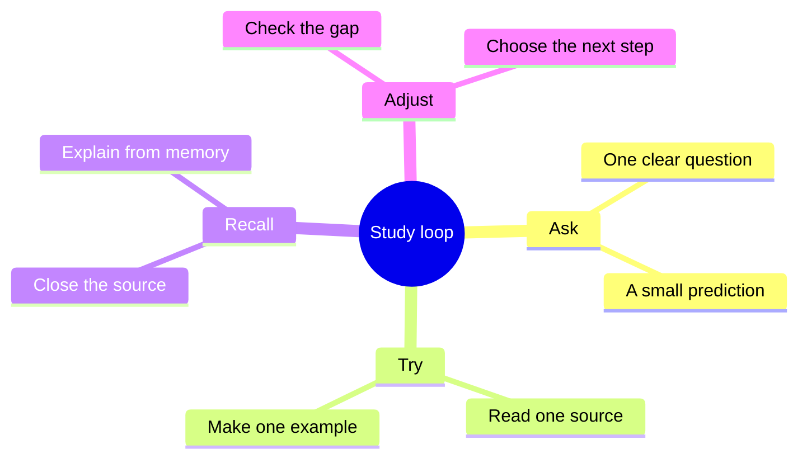

# Study loop

A short cycle is easier to repeat than an ambitious schedule. See the larger [[Learning map]] for places to begin.

> [!tip] Make recall concrete
> Explain the idea in two sentences before opening the source again.

Content: CC0 1.0 Universal.
