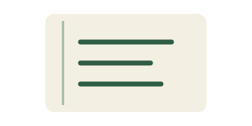
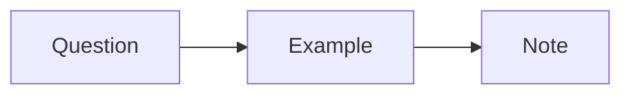

# Markdown field guide

This original note collects common Markdown and Obsidian-style syntax. Return to [[Start here|the notebook index]] when you are done.

## Inline text

Use **bold** for a main idea, *italics* for a gentle emphasis, ~~strikethrough~~ for an old choice, and ==highlight== for a phrase to revisit. Inline `code` preserves a literal name. Escape punctuation with \* when needed.

A regular [link](https://commonmark.org/) and a wiki link such as [[Study loop]] can sit in the same paragraph.[^portable]

%% This is an Obsidian-style comment, kept in the plain Markdown file. %%

### Lists and tasks

- A question worth asking
- A small example
  - A detail to test
  - A detail to compare

1. Ask.
2. Try.
3. Recall.

- [x] Write a concrete question.
- [ ] Explain the answer from memory.

### Quotations and callouts

> A useful note leaves a path back to the idea.
>
> This is an original example quotation.

> [!note] Keep the context
> Link the example to [[Project workflow]] so it can be found again.

> [!warning] Avoid an oversized session
> Stop when you have one useful observation.

## Tables

| Activity | Small output | Next step |
| :--- | :---: | ---: |
| Read | One question | Recall |
| Practice | One example | Compare |
| Review | One change | Repeat |

## Code

```python
def next_step(question: str) -> str:
    return f"Try one example of {question}."
```

## Mathematics

A simple average is $\bar{x} = \frac{1}{n} \sum_{i=1}^{n} x_i$.

$$
a^2 + b^2 = c^2
$$

## Images and embeds



![[Study loop]]

## A short diagram



---

[^portable]: The source remains a regular UTF-8 Markdown file.

Content: CC0 1.0 Universal.
