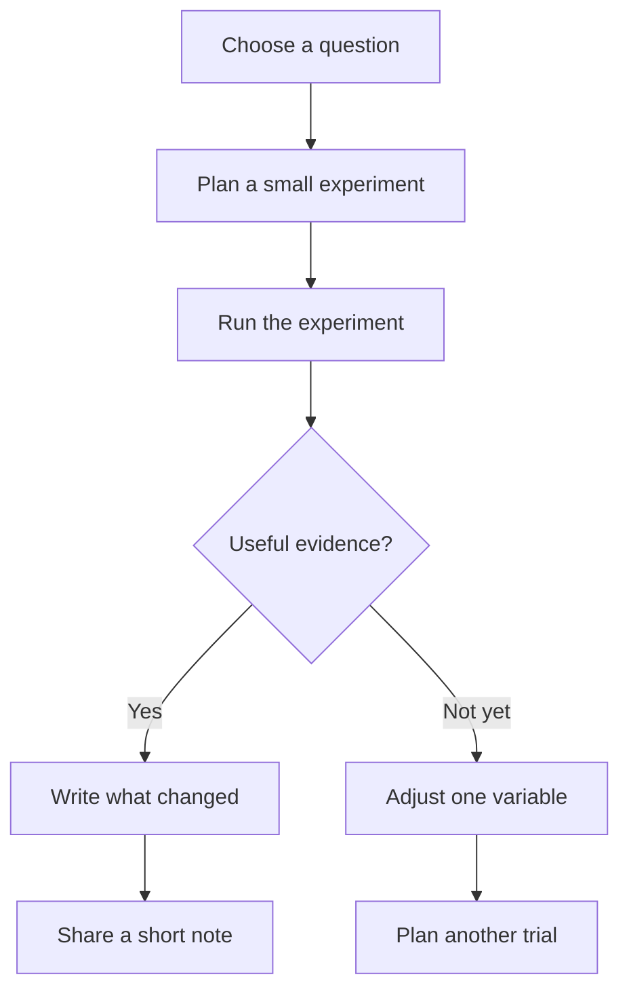

# Project workflow

A small project has a question, an experiment, and a decision. Keep the result in [[Weekly review]].

- [x] Define what a useful result would look like.
- [ ] Keep the experiment small enough for one session.
- [ ] Link the result back to the question.

Content: CC0 1.0 Universal.
