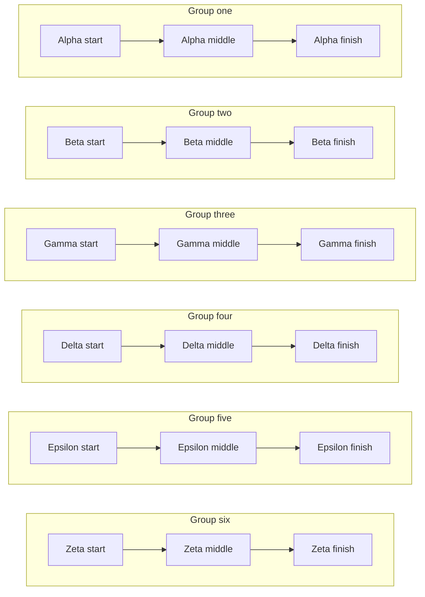

# 双图间距

首次打开时先看到第一张图，第二张图在文末。

第一张图与第二张图之间是一段普通正文。这里只用来形成稳定的正常间隔，不承载产品含义。

## 尾部

下面这段正文把第二张图推到初始视口之外，同时保证滚动回来时能再次测量同一段间距。

- 第一行用于撑开正文高度。
- 第二行用于撑开正文高度。
- 第三行用于撑开正文高度。
- 第四行用于撑开正文高度。
- 第五行用于撑开正文高度。
- 第六行用于撑开正文高度。
- 第七行用于撑开正文高度。
- 第八行用于撑开正文高度。
- 第九行用于撑开正文高度。
- 第十行用于撑开正文高度。
- 第十一行用于撑开正文高度。
- 第十二行用于撑开正文高度。
- 第十三行用于撑开正文高度。
- 第十四行用于撑开正文高度。
- 第十五行用于撑开正文高度。
- 第十六行用于撑开正文高度。
- 第十七行用于撑开正文高度。
- 第十八行用于撑开正文高度。
- 第十九行用于撑开正文高度。
- 第二十行用于撑开正文高度。
- 第二十一行用于撑开正文高度。
- 第二十二行用于撑开正文高度。
- 第二十三行用于撑开正文高度。
- 第二十四行用于撑开正文高度。
- 第二十五行用于撑开正文高度。
- 第二十六行用于撑开正文高度。
- 第二十七行用于撑开正文高度。
- 第二十八行用于撑开正文高度。
- 第二十九行用于撑开正文高度。
- 第三十行用于撑开正文高度。

文末的图：

